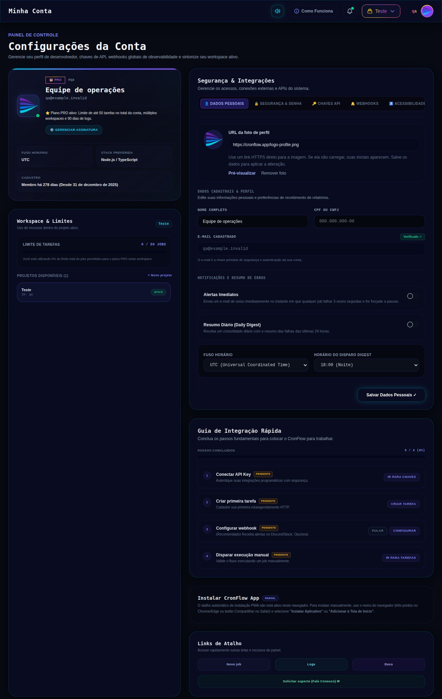
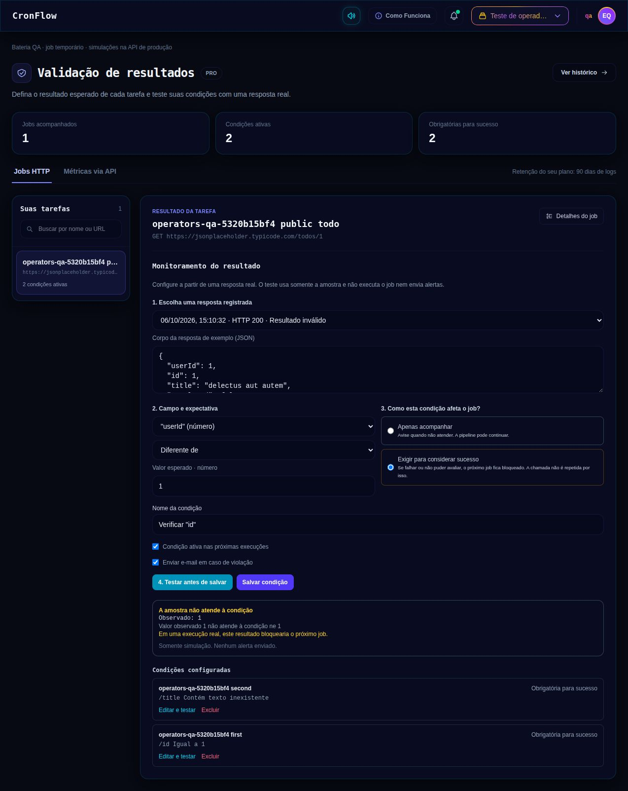

# Foto de perfil e bateria de validação — 2026-10-06

## Foto por URL

Migration 019 adiciona `users.avatar_url` opcional, com limite de 2048 caracteres. Atualização do perfil aceita `avatar_url`: valor HTTPS salva, string vazia remove, campo ausente ou null preserva a foto. Login, verificação de e-mail e consulta do perfil retornam `avatarUrl`. URLs com credenciais, esquemas inseguros ou excesso de tamanho são rejeitadas; o backend não baixa a imagem.

Perfil permite colar URL, pré-visualizar, remover e salvar junto aos dados pessoais. O avatar do perfil e do menu recebe a URL pela mesma store. Imagem indisponível ou URL vazia usa as iniciais; trocar uma URL que falhou por outra válida recupera a imagem. Imagens usam `referrerPolicy="no-referrer"`. O contorno Pro permanece, com foto estática.

O teste integrado em banco novo identificou `ai_queries_used` usada pelo perfil sem migration correspondente. Migration 020 adiciona a coluna somente quando ausente e preserva contadores existentes; o rollback não remove dados de uso. Em produção, essa coluna já existia e não foi alterada.

## Verificações locais

- Suíte Go completa passou, incluindo a matriz de operadores tipados.
- PostgreSQL descartável: criação e leitura de usuário, salvar URL, preservar em cliente antigo/null, substituir com trim, rejeitar URL insegura/credenciais sem alterar foto e remover. Migration 019 também verificada em rollback e reaplicação.
- Build e ESLint nos arquivos alterados passaram; teste de renderização verifica fallback, recusa de URL insegura e referrerPolicy.
- Navegador com perfil real e dados fictícios: imagem carregou em três locais (menu, cartão do perfil, prévia); salvar sincronizou a store; URL quebrada mostrou iniciais; outra URL válida recuperou a imagem; remover e salvar eliminou as três imagens.

## Publicação

API e frontend publicados. Migrações 019 e 020 aplicadas em transação após backup do banco. Nova API green ativa na porta 8083, habilitada no boot; tráfego trocado após health checks. Worker e scheduler continuam ativos.

Backup: `/opt/cronflow/backups/avatar-20261006T180514Z` (banco, API anterior, frontend e configuração do upstream). API versão `avatar-20261006`; hash `355ecebc53ae641490043ed9613551b31528beaa2f79ce8ec1727e672e42d8d4`. Frontend público conferido com o artefato local, hash do index `fb2468150f0d14b8b0b53311b69f45b5520da9221b48d1635304fd3247b04075`.

## Bateria em produção: entrada, saída e resultado

Job temporário em projeto isolado, sem regras globais nem alertas de teste. URL pública: [JSONPlaceholder /todos/1](https://jsonplaceholder.typicode.com/todos/1). A resposta HTTP real retornou `id=1`, `userId=1`, `title="delectus aut autem"` e `completed=false`. Foram verificados 24 casos completos: simulação read-only, salvar a condição, execução real pelo worker, status HTTP e de transporte, status efetivo e snapshot do valor observado/esperado.

| Campo | Valor observado | Comparação | Entrada esperada | Simulação | Execução |
|---|---|---|---|---|---|
| `/id` | `1` | Igual a | `1` | `pass` | `success` |
| `/id` | `1` | Igual a | `2` | `fail` | `validation_failed` |
| `/id` | `1` | Diferente de | `2` | `pass` | `success` |
| `/id` | `1` | Diferente de | `1` | `fail` | `validation_failed` |
| `/id` | `1` | Maior que | `0` | `pass` | `success` |
| `/id` | `1` | Maior que | `1` | `fail` | `validation_failed` |
| `/id` | `1` | Maior ou igual | `1` | `pass` | `success` |
| `/id` | `1` | Maior ou igual | `2` | `fail` | `validation_failed` |
| `/id` | `1` | Menor que | `2` | `pass` | `success` |
| `/id` | `1` | Menor que | `1` | `fail` | `validation_failed` |
| `/id` | `1` | Menor ou igual | `1` | `pass` | `success` |
| `/id` | `1` | Menor ou igual | `0` | `fail` | `validation_failed` |
| `/title` | `"delectus aut autem"` | Igual a | `delectus aut autem` | `pass` | `success` |
| `/title` | `"delectus aut autem"` | Igual a | `outro título` | `fail` | `validation_failed` |
| `/title` | `"delectus aut autem"` | Diferente de | `outro título` | `pass` | `success` |
| `/title` | `"delectus aut autem"` | Diferente de | `delectus aut autem` | `fail` | `validation_failed` |
| `/title` | `"delectus aut autem"` | Contém texto | `aut` | `pass` | `success` |
| `/title` | `"delectus aut autem"` | Contém texto | `inexistente` | `fail` | `validation_failed` |
| `/completed` | `false` | Igual a | `false` | `pass` | `success` |
| `/completed` | `false` | Igual a | `true` | `fail` | `validation_failed` |
| `/completed` | `false` | Diferente de | `true` | `pass` | `success` |
| `/completed` | `false` | Diferente de | `false` | `fail` | `validation_failed` |
| `/userId` | `1` | Igual a | `1` | `pass` | `success` |
| `/userId` | `1` | Diferente de | `1` | `fail` | `validation_failed` |

Em todos os casos acima, HTTP = 200 e transporte = success. Condição obrigatória atendida gera success; não atendida gera validation_failed. O job permanece ativo e o contador de falhas de transporte continua zero.

Também foram executados dois casos com duas condições obrigatórias em campos distintos: ambas atendidas produzem success; somente a segunda não atendida produz validation_failed, com snapshots independentes pass/fail. Nulo igual/diferente, campo ausente e tipo divergente foram avaliados adicionalmente pela API de preview usando amostras controladas.

## Frontend conectado à avaliação real

O navegador usou os componentes reais da central de validação e um proxy temporário limitado ao job de teste e à simulação. As credenciais ficaram apenas na memória do processo Python; o navegador recebeu a resposta pública e resultados reais da API de produção. Foram selecionados campos e operadores e preenchidos valores para os mesmos 24 casos; todos os resultados visuais corresponderam aos snapshots das execuções.

Foram conferidas as opções por tipo: número oferece eq/ne/gt/gte/lt/lte; texto oferece eq/ne/contains; booleano e nulo oferecem eq/ne. Alterar campo, operador ou expectativa invalida a simulação e desabilita salvar até testar novamente. Também passaram três verificações no navegador com amostra controlada: nulo igual, nulo diferente e campo ausente; JSON inválido bloqueou teste e salvamento. Total: 27 resultados avaliados no navegador, além da proteção para JSON inválido.

## Foto na API de produção e limpeza dos testes

Passaram salvar/consultar a URL HTTPS, atualização antiga sem avatar_url preservando a foto, rejeição de URL inválida sem alterar o perfil e remoção. As preferências pessoais foram conferidas em cada etapa. A foto original foi restaurada ao final. Job temporário, suas regras e workspace isolado foram removidos. Um workspace vazio do primeiro ensaio, interrompido por uma diferença de casing no ID retornado pela API, também foi removido antes da bateria completa. Proxy e servidor de desenvolvimento encerrados; fixtures de UI removidas do frontend.

Evidências estruturadas: [execuções e previews](assets/operators-production-results.json) e [seleções no navegador](assets/operators-browser-results.json).

Auditoria final somente leitura no PostgreSQL de produção confirmou zero projetos, zero jobs e zero regras restantes com os nomes exatos dos dois ensaios QA desta bateria. Health check público ao concluir os testes confirmou API `avatar-20261006`, PostgreSQL e Redis disponíveis.
