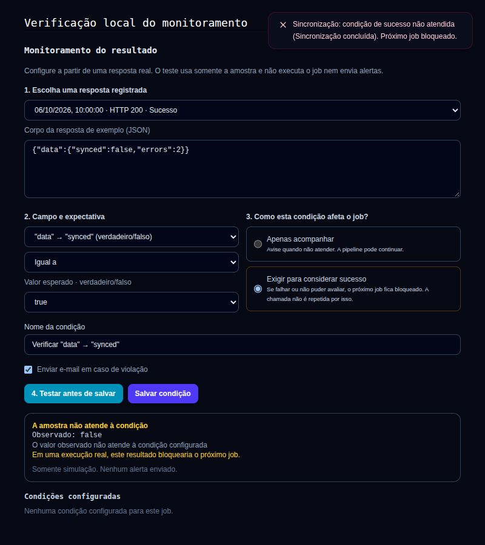

# Monitoramento do resultado — fase 2

Implementação centrada nos jobs HTTP do Cronflow, dando continuidade à análise e à fase 1.

## Fluxo no job

O formulário de detalhes do job contém o monitoramento diretamente, sem portal baseado em buscas de elementos no DOM:

1. Escolher uma execução registrada ou colar uma resposta JSON completa.
2. Selecionar um campo real e definir operador e expectativa compatíveis com o tipo encontrado.
3. Escolher entre **acompanhar** e **exigir para considerar sucesso**.
4. Testar a amostra antes de salvar. Alterar qualquer configuração ou a amostra invalida a prévia e exige outro teste.

Campos escalares de objetos e arrays são selecionáveis. Caminhos novos usam JSON Pointer para distinguir pontos, barras e nomes vazios nas propriedades. Caminhos legados com pontos continuam funcionando. Campos acima de 100 caracteres, profundidade acima de 32 e mais de 500 opções não são oferecidos pelo seletor.

O teste usa `POST /v1/monitor/preview-rule` com a configuração candidata e o corpo original como texto, preservando precisão numérica. O backend verifica a vinculação do job ao projeto autenticado, substitui qualquer projeto informado no corpo e utiliza o mesmo avaliador das execuções reais. Não grava regras, métricas ou execuções e não dispara e-mail/webhook. Uma amostra que não atende pode ser salva depois de testada: o resultado e seu efeito ficam visíveis.

O log guarda uma prévia de até 2 KiB, enquanto a avaliação real usa até 256 KiB. Se a prévia não contiver o campo ou estiver cortada, é necessário colar uma resposta completa. A interface não executa automaticamente o endpoint para obter uma amostra.

## Semântica da execução

| Situação | Resultado | Próximo job | Retry por validação | Agendamento |
|---|---|---|---|---|
| HTTP válido e condições obrigatórias atendidas | `success` | Continua | Não | Ativo |
| Condição apenas de acompanhamento não atendida/erro | `success`, com avaliação registrada | Continua | Não | Ativo |
| Condição obrigatória não atendida, erro ou não avaliada | `validation_failed` | Bloqueado | Não | Ativo |
| Falha ao carregar as condições | `validation_failed`, `evaluation_unavailable` | Bloqueado por precaução | Não | Ativo |
| Falha HTTP/transporte | Comportamento de falha existente | Bloqueado | Política existente | Política existente |

`transport_status` distingue o sucesso HTTP do resultado final. A falha de validação não aumenta o contador de falhas de transporte nem causa suspensão automática após quatro execuções. Todos os requisitos ativos precisam passar para encadear o próximo job. Não há rollback de efeitos já produzidos pela chamada HTTP.

Condições globais e antigas permanecem com `mode=observe` e `value_type=legacy`. Uma condição obrigatória exige um job específico. Tipos novos são `number`, `string`, `boolean` e `null`, com operadores validados no serviço. Atualizações de clientes antigos que omitem os campos novos preservam o modo e tipo existentes.

Histórico, filtro dos logs, Kanban e detalhes distinguem resultado inválido de erro HTTP. A telemetria inclui resultado inválido nas contagens de falha. O painel do job mantém o limite existente de uma condição no plano Free.

## Pop-ups no navegador

Reutiliza `ToastHost`, já presente no Kanban. Enquanto a aplicação está aberta e autenticada, consulta as execuções do projeto ativo a cada 10 segundos:

- Falha HTTP/timeout: aviso de erro.
- Condição obrigatória não atendida: aviso de resultado inválido e bloqueio do próximo job.
- Condição de acompanhamento não atendida: aviso de atenção.
- Erro de avaliação: aviso de erro.

O primeiro resultado estabelece uma referência e não reproduz falhas antigas. O cursor inclui IDs na mesma data, preserva precisão temporal e evita duplicar avisos em consultas vazias ou repetidas. Janelas com vários resultados são paginadas e agrupadas em um aviso. A troca de projeto cancela as consultas anteriores. Falhas de consulta não avançam o cursor. Avisos de erro/atenção ficam sete segundos visíveis.

São pop-ups **dentro da aplicação**, não notificações nativas do sistema e não push com o navegador fechado. A deduplicação vale para a sessão de acompanhamento; não há agrupamento durável de incidentes ou alerta de recuperação nesta fase. Uma nova execução problemática pode produzir um novo aviso. Nenhum payload é incluído no pop-up.

## Migration e publicação

Aplicar as migrations 016 e `017_monitor_success_conditions.up.sql` **antes** de atualizar API e worker. Aplicar também 018 para reparar instalações que já possuíam `job_id` sem sua chave estrangeira; ela preserva vínculos históricos órfãos e impõe integridade nos novos vínculos e exclusões. Ela adiciona modo e tipo nas regras, restrições de integridade e o status de transporte nas execuções. O frontend deve ser publicado junto da versão nova da API. A migration foi validada em banco temporário isolado e, após autorização, aplicada em produção em 6 de outubro de 2026. API, worker e frontend foram publicados. Veja `MONITORING_PRODUCTION_VALIDATION_2026-10-06.md` para as evidências e os limites da validação real.

A reversão traduz `validation_failed` para o status de transporte, remove os campos novos e conserva a evidência em `rule_evaluations`. Reverter exige considerar a perda da distinção tipada no comportamento legado.

## Verificações

- Suíte Go completa, incluindo Redis local.
- Avaliador: JSON Pointer, tipos, precisão, campos ausentes e condições obrigatórias.
- Serviço e HTTP: prévia candidata sem efeitos, projeto autenticado e contrato de casing do frontend.
- Worker com transporte controlado: bloqueio/continuidade, nenhuma repetição por validação e nenhum incremento de falhas HTTP.
- PostgreSQL temporário: migrations completas, defaults legados, restrição de job obrigatório, reversão/reaplicação e criação/edição/leitura de regras e execuções.
- Frontend: build de produção, lint dos componentes alterados e `npm run test:monitoring-ui`.
- Navegador com fixture isolada: seleção de resposta/campo, requisito de sucesso, prévia, invalidação após edição, salvamento e confirmação por toast. A consulta periódica detectou uma nova execução fictícia e exibiu o pop-up de falha. Não usou conta nem endpoint real.

O teste de persistência pode ser repetido com `CRONFLOW_MONITOR_TEST_DSN` apontando explicitamente para um banco descartável migrado e `go test ./internal/repository/postgres -run TestMonitorPersistenceIntegration -count=1`.
