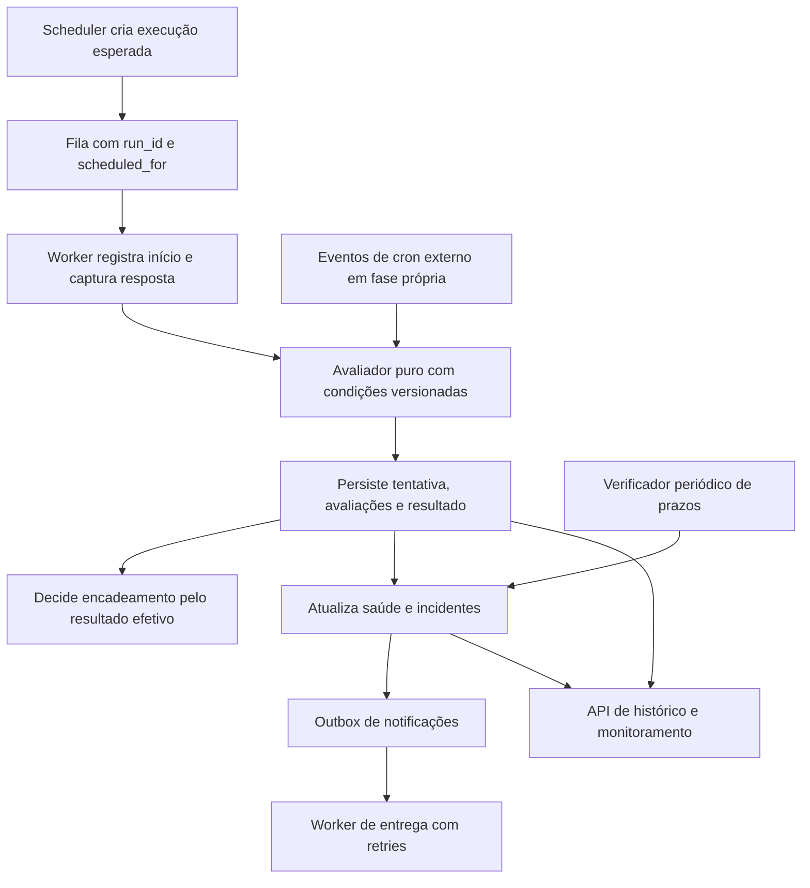

# Monitoramento do Cronflow: diagnóstico e proposta de refatoração

Data: 6 de outubro de 2026. Status: proposta para orientar implementação.

## 1. Direção do produto

O Cronflow se propõe a agendar, executar e encadear tarefas HTTP para desenvolvedores e pequenos SaaS. O monitoramento precisa fechar esse ciclo: **mostrar se a automação entregou o resultado esperado, no prazo esperado, com evidência suficiente para corrigir problemas**.

Uma resposta HTTP 200 confirma uma interação HTTP bem-sucedida segundo determinado contrato. Ela não garante que vendas foram sincronizadas, que um backup foi criado ou que uma fila foi processada. O valor do monitoramento está em tornar essa diferença visível e permitir ações proporcionais ao problema.

Exemplo: o job de sincronização retorna `{"success":true,"processed":0,"errors":12}`. O usuário precisa ver que a chamada respondeu, mas o resultado não atendeu às condições configuradas. Deve poder abrir a execução, entender o motivo e decidir se isso só gera um alerta ou também impede a etapa seguinte.

Escopo confirmado pelo usuário: priorizar os jobs HTTP executados pelo próprio Cronflow. Crons externos ficam como expansão posterior, com origem e contrato próprios. O desenho não depende de tratar uma chave global como identidade de monitor.

## 2. Método e limites da análise

Foram inspecionados o domínio, serviço, handlers, repositórios, migrations, worker, scheduler, fila e componentes React relacionados a monitoramento e logs. Os READMEs ajudam a identificar a intenção; o código foi usado como evidência do comportamento atual.

A pesquisa externa utilizou documentação oficial de Cronitor, Healthchecks.io, EasyCron e Datadog. São referências de categorias próximas, não um padrão normativo único. As decisões propostas abaixo são uma síntese para o contexto do Cronflow, e não a reprodução integral de um concorrente.

Os testes existentes de `internal/service` e `pkg/httputil` passaram. Os pacotes `internal/worker` e `internal/repository/postgres` não têm arquivos de teste. Isso não comprova o fluxo completo com PostgreSQL, Redis e interface. Não foi feita validação do serviço em produção nem inspeção visual da aplicação em execução. Os achados de comportamento integrado são derivados do código.

## 3. O que existe hoje

Há dois caminhos distintos que compartilham as mesmas regras e valores:

1. `POST /v1/monitor/check` recebe uma chave e um valor, grava o último valor do projeto, consulta regras e envia alertas.
2. O worker executa um job HTTP, tenta interpretar o corpo como objeto JSON, extrai campos por notação com pontos e avalia regras do job e regras globais.

O domínio possui regras com chave, operador, limite textual e canais de alerta. O resultado por execução contém ID, nome, `passed` e mensagem. A tela principal oferece formulários de ingestão e criação, seguidos de uma tabela de configurações. Não apresenta uma visão persistida da saúde dos monitores.

Há peças úteis para aproveitar: isolamento de projeto na autenticação, associação opcional com job, extração de campos aninhados, armazenamento JSONB das avaliações, infraestrutura de filas e cliente HTTP com proteção de rede.

## 4. Problemas encontrados e suas consequências

| Prioridade | Evidência no código | Consequência para o usuário | Direção proposta |
| --- | --- | --- | --- |
| P0 | `pkg/httputil/client.go:177–183` lê somente 2 KB; `internal/service/monitor_service.go:154–158` ignora JSON inválido | Um JSON maior pode ser cortado e nenhuma condição de payload é avaliada, sem motivo visível | Avaliar um corpo completo dentro de limite explícito; separar prévia de log e entrada de avaliação |
| P0 | `internal/worker/worker.go:91–107` descarta o booleano de violação; o encadeamento usa apenas `execStatus` | HTTP 200 com regra violada continua como sucesso e pode liberar o próximo job | Separar transporte, validação e resultado efetivo; condição bloqueante deve governar encadeamento |
| P0 | `internal/service/monitor_service.go:176–185` registra `Passed:false` para campo ausente, mas não atualiza `hasViolation` nem envia alerta nesse ramo | O resultado agregado diverge do resultado individual | Tratar ausência explicitamente e derivar agregação de todos os resultados |
| P0 | `internal/service/monitor_service.go:149–158` retorna vazio para corpo vazio ou inválido antes de buscar regras | Não é possível distinguir ausência de regras de impossibilidade de avaliar regras existentes | Persistir `skipped`, `error` ou falha de contrato com motivo |
| P1 | `MonitorPage.tsx:125` usa `/monitor/check` como teste; `IngestAndEvaluate` grava e notifica | Uma simulação modifica valores reais e pode enviar alertas reais | Endpoint de prévia sem efeitos colaterais |
| P1 | `monitor_repository.go`, `ListRulesByKey`, filtra projeto e chave, sem filtrar `job_id` | Ingestão manual pode avaliar regras vinculadas a outros jobs do mesmo projeto | Identificar origem e monitor explicitamente |
| P1 | Migration 015 e `UpsertKeyValue` usam unicidade `(project_id,key)` | Jobs diferentes com `status` ou `count` sobrescrevem o mesmo último valor | Associar amostras ao monitor, origem e execução |
| P1 | `evaluateRule` converte valores para string e compara texto quando a conversão numérica falha | `"error" > "100"` pode ser aceito por ordenação textual; booleano e string perdem distinção | Comparadores tipados e erro de tipo explícito |
| P1 | `extractJSONField` percorre apenas mapas | Arrays, índices e nomes de campo contendo pontos não têm seleção inequívoca | Seletor estruturado com segmentos de chave/índice e contrato documentado |
| P1 | Serviço notifica a cada violação; `NotifyKeyViolation` usa goroutine e registra inclusive respostas HTTP não bem-sucedidas como entrega | Repetição de alertas e falta de confirmação durável de entrega | Incidentes, deduplicação e fila de notificações com tentativas |
| P1 | `CreateWithRuleEvaluations` grava JSONB, mas `ListByJob` e `ListByProject` não o selecionam; `GetRuleEvaluations` não tem chamada no fluxo inspecionado | Evidência gravada não chega ao histórico normal da API; `LogEntry` também não a tipa | Entregar avaliações junto do detalhe da execução |
| P1 | Tela carrega regras na montagem e apresenta configurações, sem estado, frescor ou série de avaliações | O usuário administra regras, mas não acompanha o que está acontecendo | Visão operacional com situação, motivo, valor, horário e histórico |
| P1 | Handler/service de criação não verificam pertencimento do `job_id` ao projeto; FK valida somente existência | Associação incoerente entre projetos pode ser aceita | Validar pertencimento na API e reforçar integridade no banco |
| P2 | Limite Free e exigência de webhook Pro aparecem no frontend; as rotas de monitor não usam enforcement equivalente no caminho inspecionado | Política comercial pode ser contornada por chamada direta à API | Aplicar cotas de forma atômica no backend e alinhar comunicação |
| P2 | `LogDetail.tsx:222–254` escolhe a primeira chave e usa `String(...)`; o formulário mantém operador padrão `gte` | Sugestão pode virar comparação inadequada de texto/objeto e campo arbitrário | Deixar o usuário selecionar o campo real e sugerir operador pelo tipo |

Os testes atuais verificam operadores e campos aninhados comuns. Não cobrem as interações acima. A refatoração precisa testar contratos entre captura, avaliação, persistência e decisão de execução.

## 5. Referências da indústria

| Referência | Comportamento documentado | Aplicação ao Cronflow |
| --- | --- | --- |
| Cronitor | Distingue monitores de jobs, checks HTTP e heartbeats; configura agendamento, assertions, tolerância e notificações | Origem explícita e condições de saúde compreensíveis. [Monitor API](https://cronitor.io/docs/monitors-api) |
| Healthchecks.io | Recebe sinais de execução, acompanha atrasos com margem e muda de estado quando a execução esperada não chega | Detectar jobs ausentes também exige relógio e expectativa, não apenas avaliar respostas recebidas. [Documentação](https://healthchecks.io/docs/) |
| EasyCron | Permite combinar HTTP 2xx com expressão regular sobre o corpo para julgar sucesso | A saída pode participar do contrato de sucesso de uma tarefa agendada. [Critérios de sucesso](https://www.easycron.com/document/add) |
| Datadog Synthetics | Oferece assertions sobre status, tempo, headers e corpo, incluindo JSONPath/JSON Schema; usa resposta de teste para ajudar a configurar assertions | Construção de condições a partir de resposta real, com múltiplas dimensões observáveis. [HTTP Testing](https://docs.datadoghq.com/synthetics/api_tests/http_tests/) |
| Cronitor Custom Metrics | Associa métricas a eventos, oferece histórico/agregações e distingue ausência de amostra de zero | Preservar origem, tempo e gaps no histórico; definir política de ausência. [Custom Metrics](https://cronitor.io/docs/custom-metrics) |

Inferência de projeto: o ponto comum útil é **origem → observação → expectativa → estado → ação**. Nenhuma ferramenta justifica tratar dados ausentes como resultado saudável por padrão. As políticas exatas variam: por exemplo, Cronitor documenta que métricas customizadas ausentes são puladas e que a tolerância geral de falhas não se aplica às assertions dessas métricas. O Cronflow deve explicitar sua própria política, especialmente para campos obrigatórios de resposta.

## 6. Modelo de comportamento recomendado

### 6.1 Três perguntas independentes

| Dimensão | Pergunta | Exemplo de problema |
| --- | --- | --- |
| Agendamento | A execução esperada começou e terminou dentro da margem? | O worker ficou indisponível e nenhum resultado chegou |
| Transporte | A requisição foi concluída segundo o contrato HTTP? | Timeout, DNS, HTTP 500 ou status inesperado |
| Resultado | A resposta atendeu às condições da automação? | `success=false`, campo ausente ou `errors>0` |

Na primeira versão, o monitoramento de resultado deve usar a resposta HTTP. O payload enviado é configuração da requisição; não é prova do que o destino realizou. A interface deve dizer “corpo da resposta” em vez de “payload” quando essa for a origem.

Para respostas HTTP 202, deixar claro que houve aceitação. Uma API que realiza o trabalho depois precisa informar conclusão por callback ou consulta posterior. Não apresentar “backup concluído” com base apenas em aceite HTTP. Esse modo exige outra fase do produto.

### 6.2 Resultado de cada condição

Substituir o booleano isolado por resultado explícito:

- `pass`: valor observado atende à condição.
- `fail`: contrato foi violado, incluindo campo obrigatório ausente.
- `error`: não foi possível avaliar por falha interna ou captura incompleta.
- `skipped`: condição não se aplica ou campo opcional não foi fornecido, conforme política configurada.

JSON inválido para uma condição que exige JSON é falha do contrato (`fail`, motivo `invalid_json`). Corpo excedendo o limite de captura é `error`, motivo `body_too_large`; não avaliar fragmento como se fosse documento completo. Em falha de rede sem resposta, condições de corpo ficam `skipped`, motivo `no_http_response`, e a falha de transporte governa o resultado.

Cada avaliação deve guardar valor observado tipado, valor esperado tipado, seletor, operador, motivo, horário, ID da execução/tentativa e versão da condição. Isso permite explicar o passado mesmo após editar a configuração.

Tipos mínimos: número, texto, booleano e null. `exists` e `not_exists` não exigem limite; `eq` e `ne` preservam tipo. `true` não equivale a `"true"`. Comparações de ordem exigem número finito; não usar ordenação textual como alternativa automática. Validar limites já na criação. Preservar precisão numérica na decodificação e definir limites do comparador.

Seleção inicial: caminhos com chaves e índices explícitos, sem wildcards ou execução de código. O builder gera esses segmentos a partir da árvore JSON; a exibição pode usar `data.items[0].status`. Chaves com ponto permanecem uma chave inteira. Declarar a sintaxe suportada; não chamar esse subconjunto de JSONPath completo. JSON Schema, regex e agregações de arrays ficam para uma expansão justificada por casos reais.

### 6.3 Duas intenções de configuração

**Condição de sucesso:** `data.synced` deve ser `true`. Se falhar, o resultado efetivo da execução é falha de validação e o próximo job não é liberado.

**Condição de acompanhamento:** `queue_depth` deve ser menor que 100. A violação cria um problema de monitoramento, mas pode permitir o encadeamento porque não invalida o trabalho realizado.

O usuário escolhe essa intenção com linguagem simples: “Esta condição precisa passar para considerar a execução concluída”. Não exigir conhecimento de política interna de workflow.

Falha de validação não deve provocar repetição automática de uma chamada com efeitos colaterais. Na primeira versão, não repetir por payload por padrão. Repetição depende de política explícita e suporte a idempotência; falhas de transporte preservam inicialmente a política existente. Uma violação de monitoramento também não deve suspender automaticamente o agendamento: continuar observando permite detectar recuperação. A suspensão já existente por falhas de transporte é outra política, cuja revisão exige cuidado e não deve ser alterada incidentalmente. Não reescrever retroativamente resultados de execuções antigas.

### 6.4 Estado operacional

Guardar separadamente configuração (ativo/pausado), frescor (atual/atrasado) e saúde (aguardando dados/saudável/pendente/falhando/indeterminada). A UI pode apresentar uma situação resumida com explicação, mas a API não deve comprimir tudo em `passed`.

Uma observação ruim pode ficar pendente antes de abrir incidente, segundo tolerância configurada. Uma condição de sucesso bloqueante falha imediatamente na execução, mesmo que o alerta aguarde confirmação. **Tolerância de alerta não transforma execução inválida em sucesso.**

Valor antigo não comprova saúde atual. Sem primeira amostra, mostrar “Aguardando primeira execução”. Ao ultrapassar a expectativa, mostrar “Sem resultado desde…” e abrir incidente segundo a margem. Uma amostra ausente nunca vira zero.

## 7. Experiência do usuário

### 7.1 Entrada principal pelo job

O fluxo recomendado é: abrir job → aba “Monitoramento” → escolher resposta existente → selecionar campo → definir expectativa → visualizar teste → ativar.

Exemplo com `{"data":{"synced":true,"processed":842,"errors":0}}`:

| Campo selecionado | Tipo reconhecido | Expectativa escolhida | Última observação |
| --- | --- | --- | --- |
| `data.synced` | Booleano | Deve ser `true` | `true`, passou |
| `data.processed` | Número | Deve ser maior que `0` | `842`, passou |
| `data.errors` | Número | Deve ser igual a `0` | `0`, passou |

A seleção é deliberada. O valor da amostra pode sugerir uma igualdade para texto/booleano, mas não define automaticamente um limite de negócio. Uma amostra com 842 itens não justifica impor mínimo de 842 nas próximas execuções.

A prévia mostra o que passaria/falharia sobre a amostra, sem gravar telemetria, abrir incidente ou notificar. Usar um log existente ou resposta colada não executa uma nova chamada. “Executar job agora” continua sendo outra ação explícita, pois uma chamada POST pode realizar trabalho real.

### 7.2 Página de monitoramento

A página deve abrir na visão operacional, com filtros por job, situação e período. Cada linha mostra job/origem, condição legível, valor atual, expectativa, última avaliação, próxima expectativa e motivo do problema. O detalhe mostra histórico e incidente.

Exemplo de informação útil: “Sincronização de vendas · Resultado inválido · errors = 12, esperado 0 · há 2 minutos · Abrir execução”. A linha leva à evidência que explica a falha. Regras e canais ficam nas configurações do monitor.

Atualizar automaticamente consultas visíveis e invalidá-las após edição e execução; começar com polling moderado, por exemplo 15–30 segundos, suspendendo em aba oculta. Exibir horário e erro de atualização. SSE pode vir depois se houver demanda de latência. Dados dinâmicos precisam primeiro de estado confiável no backend.

Criar, editar, pausar e retomar devem funcionar no contexto do job. Substituir prefill via `localStorage`, eventos globais e portal dependente de seletor CSS por estado de navegação e componentes compartilhados. Centralizar tipos e conversão de nomes de campos.

### 7.3 Integração externa

Se o escopo incluir crons externos, oferecer um fluxo separado “Monitorar tarefa externa”. O usuário configura identidade, periodicidade e margem; recebe um token exclusivo para enviar `start`, `complete` e `fail`, com `run_id` e métricas opcionais. Esse modelo permite saber quando a tarefa não aconteceu. A ingestão atual de uma chave solta não oferece essa garantia.

Não aplicar condições de um cron externo aos corpos de todos os jobs do projeto. Configurações compartilhadas podem virar templates associados explicitamente a vários monitores.

## 8. Arquitetura proposta

Reaproveitar Go, PostgreSQL, Redis e Asynq. O desenho não exige outro produto de observabilidade nem novos microsserviços. O avaliador deve receber observação e configuração, devolver resultados e não consultar banco ou enviar mensagens. Um serviço coordena persistência e estado.

### 8.1 Captura confiável

Separar limite de processamento do limite de prévia armazenada. Como ponto inicial sujeito a medição, capturar até 256 KiB mais um byte para detectar excesso, com timeout também durante a leitura. Avaliar o documento completo somente dentro do limite. Registrar erros de leitura, tamanho, truncamento e tipo de conteúdo. Medir tempo total até terminar a leitura: hoje `durationMs` é calculado antes dela.

Persistir somente a prévia necessária e os valores selecionados, com opção de ocultar corpo e campos sensíveis. “Não salvar corpo” pode continuar permitindo avaliação em memória. Aplicar a mesma política à prévia, histórico, mensagens de alerta e exportações. Não enviar o documento inteiro em alertas por conveniência.

### 8.2 Identidade, execução e persistência

Entidades sugeridas:

| Entidade | Responsabilidade |
| --- | --- |
| `monitors` | Projeto, origem, job quando aplicável, expectativa temporal e configuração ativa |
| `monitor_conditions` | Seletor, tipo, operador, esperado, obrigatoriedade, intenção e versão |
| `job_runs` | Ocorrência lógica com `run_id`, origem, horário esperado e resultado final |
| `executions` | Tentativas de um run, início/fim, transporte e prévia |
| `monitor_evaluations` | Resultado imutável por condição e tentativa, incluindo snapshot e observação |
| `monitor_incidents` | Problema aberto/resolvido, início, motivo e evidências |
| `notification_outbox` | Eventos de abertura/recuperação e progresso de entrega por canal |

O payload da fila hoje só contém `job_id`. O placeholder atual de `run_id` usa job e tentativa e se repete entre ocorrências. Gerar um ID real para cada ocorrência; retries compartilham esse ID e têm tentativas distintas. Guardar `scheduled_for`, `enqueued_at`, `started_at` e `finished_at` para separar atraso na fila de duração HTTP.

Criar a expectativa antes do processamento permite detectar tarefa que nunca começou. O verificador de prazos também precisa comparar o cron ativo com ocorrências esperadas ainda não criadas, pois a indisponibilidade do scheduler pode impedir a criação do run. Executar essa verificação em processo independente do scheduler, aproveitando um processo existente quando adequado; monitorar externamente a disponibilidade do próprio Cronflow para cobrir indisponibilidade total da plataforma. Para consistência PostgreSQL/Redis, usar persistência durável do run e despacho recuperável, idealmente outbox também para enfileiramento. Duplicatas devem ser reconhecidas por identidade da ocorrência; não depender apenas de lock temporal do scheduler.

Persistir avaliações, atualização de estado e evento de notificação de forma transacional. O envio ocorre depois. Usar controle de concorrência por monitor e restrição para impedir incidentes abertos duplicados. Observação atrasada de um run antigo permanece no histórico, mas não substitui silenciosamente a saúde mais recente. Definir desempate por ordem lógica e ID, não pela ordem em que o banco recebeu as escritas.

### 8.3 Alertas e recuperação

Notificar ao abrir incidente; novas violações atualizam a evidência sem novo alerta imediato. Lembretes precisam de intervalo explícito. Notificar a recuperação uma vez, após atender à política de recuperação. Falhas de avaliação interna não comprovam recuperação. Em um monitor com várias condições, resolver apenas quando todas as condições relevantes deixarem de sustentar o problema.

Agrupar falhas de um mesmo run; não contar três retries como três ocorrências agendadas. Permitir tolerância por runs concluídos para reduzir ruído sem ocultar tentativas no histórico. Entregas devem validar status HTTP, ter timeout, backoff, limite de tentativas e idempotência por evento/canal. Em entrega externa com retry, projetar para pelo menos uma entrega, não prometer exatamente uma.

### 8.4 Contratos de API

Rotas sugeridas, sujeitas às convenções finais do projeto:

- `GET /v1/monitors`: estado, frescor e última evidência por monitor.
- `POST /v1/monitors` e `PUT /v1/monitors/{id}`: configuração completa, validada e versionada.
- `POST /v1/monitors/preview`: avaliar configuração candidata sobre amostra, sem efeitos colaterais.
- `GET /v1/monitors/{id}/evaluations`: histórico paginado por período.
- `GET /v1/monitors/{id}/incidents`: incidentes e evidências.
- API de detalhe de execução: transporte, resultado efetivo e avaliações.

Preview deve autorizar acesso ao log utilizado e limitar tamanho/complexidade. Toda associação com job precisa validar projeto. Cotas de plano exigem controle transacional para criações simultâneas. Origem externa precisa de credencial própria, deduplicação de eventos e timestamp de recebimento confiável; não expor token administrativo em URLs de exemplo.

## 9. Migração sem mudança silenciosa de significado

1. Introduzir tabelas e campos novos com migrations aditivas. Preservar API v1 legada durante transição.
2. Regras vinculadas a job viram condições de acompanhamento por padrão, preservando o encadeamento atual. Conversão para condição de sucesso exige escolha explícita.
3. Regras globais ficam identificadas como legado. Não replicá-las automaticamente para todos os jobs: revisar associações com ajuda de amostras reais e prévia.
4. Limites textuais precisam de revisão de tipo. Não converter `"true"` automaticamente para booleano nem assumir que todo texto numérico é uma métrica numérica. Sugerir conversão e validar amostra/contrato.
5. Dados de `monitor_key_values` não têm origem nem série histórica; não inventar uma. Mantê-los como valor legado com essa limitação.
6. Avaliações JSONB existentes ficam preservadas. Elas não contêm todos os valores/configurações; o histórico antigo pode mostrar resultado e mensagem com “detalhes indisponíveis”.
7. Rodar o novo avaliador em paralelo inicialmente, sem alertas duplicados e sem controlar encadeamento, para comparar resultados. Fazer ativação gradual por projeto e ter opção de retorno ao caminho anterior.
8. Só remover tabelas/endpoints legados após migração verificada e janela de compatibilidade definida.

## 10. Sequência de implementação

| Fase | Entrega | Critério de conclusão |
| --- | --- | --- |
| 1 — Verdade da avaliação | Captura limitada explícita, avaliador tipado, ausência/erro, preview puro e leitura das avaliações nos logs | Nenhuma condição ativa desaparece sem resultado ou motivo; preview não altera produção |
| 2 — Resultado útil | Intenção de condição, resultado efetivo e encadeamento coerente, builder a partir de amostra | HTTP 200 com condição bloqueante falha é mostrado corretamente e não libera próximo job |
| 3 — Operação contínua | Runs reais, saúde persistida, expectativa temporal, incidentes e entrega durável | Execução ausente é detectada; violações repetidas não criam tempestade de alertas |
| 4 — Interface operacional | Visão de saúde, histórico, filtros, frescor e ações no contexto do job | O usuário identifica problema, entende evidência e abre execução sem procurar regras dispersas |
| 5 — Origens e análise avançadas | Crons externos, conclusões assíncronas e séries/agregações conforme demanda | Cada origem tem contrato de identidade, conclusão e ausência documentado |

A construção visual pode acompanhar as fases 1–3, mas não deve prometer estado que o backend ainda não sabe calcular. Conforme a prioridade confirmada, crons externos não entram no primeiro ciclo de implementação.

## 11. Cenários obrigatórios de aceitação

| Cenário | Resultado esperado |
| --- | --- |
| HTTP 200, `success=true`, condições atendidas | Transporte aprovado, validação aprovada, run concluído |
| HTTP 200, `success=false`, condição bloqueante | Falha de validação, evidência persistida, próximo job bloqueado, sem retry de payload por padrão |
| HTTP 200, métrica acima do limite de acompanhamento | Problema no monitor; execução pode continuar conforme intenção da condição |
| JSON válido com mais de 2 KB e dentro do limite novo | Campo avaliado normalmente, mesmo fora da prévia curta |
| Corpo excede o limite ou leitura falha | Erro de captura explícito; não gerar aprovação de payload |
| JSON inválido com condição JSON obrigatória | Falha de contrato com motivo; não desaparece da avaliação |
| Campo obrigatório ausente / campo opcional ausente | Falha / skipped com motivo, respectivamente |
| `0`, `false`, string vazia, null e chave ausente | Valores e ausência diferenciados; não rejeitar zero/false por serem falsy |
| Array e chave contendo ponto | Seleção inequívoca pela estrutura do caminho |
| Texto recebido em condição numérica | Erro de tipo ou falha do contrato, sem comparação lexicográfica |
| Dois jobs possuem `status` no mesmo projeto | Valores e condições permanecem isolados por origem |
| Prévia viola todas as condições | Apenas resposta de simulação; nenhuma gravação operacional ou notificação |
| Falha de rede / HTTP inesperado | Falha de transporte; corpo só é avaliado quando disponível e conforme aplicabilidade |
| HTTP 202 para operação assíncrona | Aceite visível; conclusão real não é presumida |
| Job esperado não inicia dentro da margem | Incidente de execução ausente, mesmo sem resposta HTTP |
| Três tentativas falham e uma posterior passa | Histórico preserva tentativas; política considera o run e recupera uma vez |
| Evento duplicado ou run antigo termina atrasado | Não duplica incidente/notificação nem substitui estado mais recente |
| Processo reinicia após persistir incidente | Outbox continua entrega pendente |
| Canal responde 500 | Entrega falha, é repetida segundo política e aparece com estado correto |
| Job ou log de outro projeto é referenciado | Solicitação recusada; nenhum dado é lido ou associado |
| Configuração é editada após execução | Resultado antigo mantém versão e expectativa originais |

## 12. Decisões recomendadas e pontos a validar

Adotar agora: contexto do job como entrada principal; três dimensões separadas; condições de saúde legíveis; avaliação tipada; prévia sem efeitos; origem explícita; histórico com evidência; incidentes com recuperação; bloqueio de pipeline somente para condição de sucesso; atualização automática com frescor visível.

Validar com uso real: prioridade de crons externos, proporção de endpoints síncronos/assíncronos, limite de captura, retenção, dados sensíveis e tolerância de alerta. Os valores sugeridos de captura/polling são escolhas iniciais de engenharia, não parâmetros universais da indústria.

Indicadores de qualidade para acompanhar: tempo até configurar a primeira condição, proporção de condições ativas com avaliação recente, avaliações com motivo explícito, incidentes detectados antes do usuário, repetição de alertas por incidente e tempo para chegar à execução que explica o problema. Evitar medir utilidade apenas pelo número de regras cadastradas.

A primeira entrega que prova a proposta é um fluxo completo: escolher um job real, selecionar um campo da resposta, testar a expectativa com segurança, acompanhar a próxima execução e receber um único alerta explicável quando o resultado falhar, seguido de recuperação quando voltar ao esperado.
