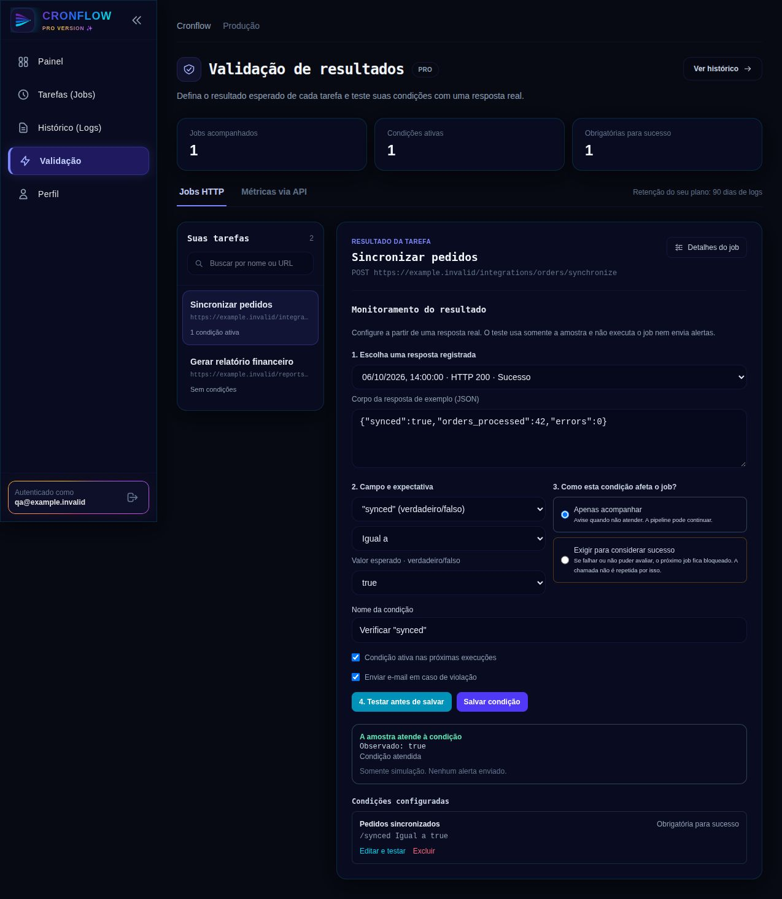
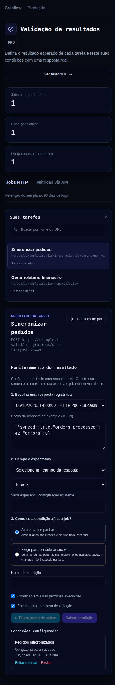
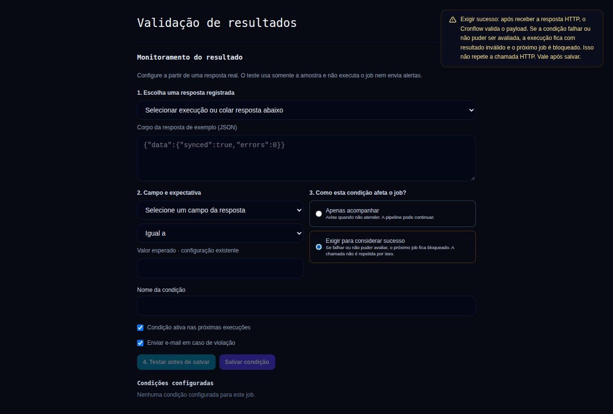

# Validação de resultados e retenção de logs — 2026-10-06

A central de Validação permanece no menu principal, integrada às tarefas e ao histórico. Jobs HTTP são a entrada principal: busca de tarefas, condições ativas, condições obrigatórias e editor compartilhado com o modal do job. Métricas globais via API ficam em uma aba secundária. O histórico abre a central com o job e a execução selecionados, sem persistir o payload no localStorage.

O editor permite selecionar uma resposta registrada, escolher o campo e o valor esperado, definir acompanhamento ou exigência de sucesso e simular antes de salvar. Alterações invalidam a simulação. A central atualiza suas contagens após salvar ou excluir. Falhas de carregamento têm opção de tentar novamente; a aba de métricas não permite criar condições enquanto a carga das regras estiver com erro.

## Retenção efetiva

A auditoria de produção confirmou Free = 7 dias, Pro = 90 dias e Starter = 7 dias. Não foram alterados os prazos comerciais. Foram encontradas cinco contas, distribuídas entre Free, Pro ativo e Pro sem assinatura. Nenhuma execução estava vencida conforme o plano efetivo no momento da auditoria. Logs Pro com mais de 30 dias permanecem válidos pelo prazo configurado de 90 dias.

Havia um risco de exclusão antecipada em contas marcadas Pro sem assinatura ativa: a consulta de limpeza só considerava assinaturas e acabava usando Free. A consulta agora segue os mesmos critérios do BillingRepository e do EntitlementEngine, incluindo a concessão explícita Pro e retenção dinâmica configurada na tabela plans.

A limpeza de logs também dependia de 2.880 ciclos e reiniciava a contagem após cada restart. Agora é verificada no primeiro ciclo disponível e a cada hora, com nova tentativa após um minuto em caso de falha. A limpeza existente de contas não verificadas mantém seu comportamento anterior. Cada limpeza de logs registra sucesso e quantidade excluída, inclusive zero. A remoção física pode ocorrer até aproximadamente uma hora após vencer a janela de retenção, conforme disponibilidade do scheduler e banco.

## Evidências de verificação

- `go test ./...` passou.
- PostgreSQL temporário, com todas as migrations: teste real de exclusão de logs vencidos e preservação de logs dentro da janela em oito cenários. Inclui Free sem assinatura, assinatura pendente/cancelada, Pro ativo/trial, Pro manual e plano dinâmico de 14 dias. Cada cenário compara os limites retornados pelo EntitlementEngine com o resultado da limpeza.
- Scheduler: testes de inicialização, intervalo horário independente da frequência de ticks, restart e retry após erro.
- Frontend: build de produção, ESLint nos arquivos alterados e `test:monitoring-ui` passaram. O aviso de bundle maior que 500 kB continua no build.
- Navegador: componentes reais com dados fictícios e respostas locais da API; desktop 1280 px e celular 390 px sem transbordamento horizontal. Seleção de job, preenchimento da resposta, simulação, invalidação após editar, salvamento e atualização das contagens verificados. A inspeção visual não utilizou credenciais de produção.

## Publicação verificada

Frontend e scheduler publicados em produção. API e worker permaneceram ativos. Backup completo antes da publicação: `/opt/cronflow/backups/validation-20261006T174253Z` (banco, scheduler anterior e frontend).

O index público e o chunk `MonitorPage-BO6lDz0O.js` correspondem aos artefatos locais. O health check público confirmou PostgreSQL e Redis disponíveis.

O scheduler registrou em `2026-10-06 17:43:27 UTC`: `limpeza de logs concluída — 0 execuções expiradas removidas`. Auditoria após a publicação: Free com 121 execuções e zero vencidas; Pro com 5.788 execuções e zero vencidas. Esses totais são uma fotografia de um sistema em funcionamento e continuam variando com novos jobs.

## Explicações ao selecionar o modo

Os modos Apenas acompanhar e Exigir para considerar sucesso exibem toasts explicativos, inclusive ao clicar novamente no modo já selecionado. O primeiro explica que a validação não bloqueia a sequência por si só; o segundo explica a avaliação após a resposta HTTP e o bloqueio do próximo job em caso de condição não atendida ou erro de avaliação. Ambos indicam que a escolha vale após salvar. Esses toasts duram 12 segundos, sem alterar a duração dos demais avisos. Verificados no navegador com os componentes reais, além de build, ESLint e teste de renderização.

